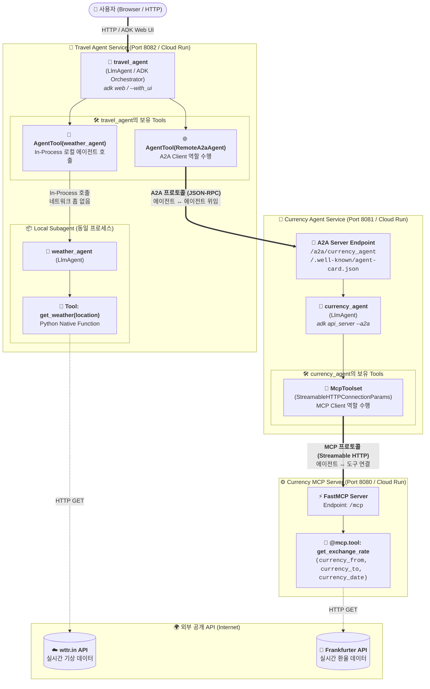
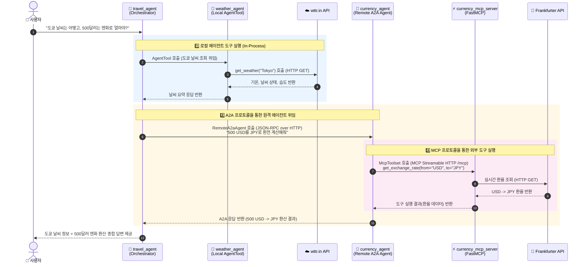

# ADK를 활용한 MCP & A2A 시작하기

[](https://www.python.org/)
[](https://github.com/google/adk-python)
[](https://github.com/google-a2a/a2a-python)
[](https://modelcontextprotocol.io/)
[](LICENSE)

**Model Context Protocol (MCP)**과 **Agent2Agent (A2A)**가 **Agent Development Kit (ADK)**와 함께 상호작용하는 샘플 멀티 에이전트 시스템입니다.
모든 서비스는 ADK 모범 사례(Best Practices)를 준수하며, ADK CLI를 통해 로컬에서 완전히 실행하거나 Google Cloud Run에 배포할 수 있습니다.


---

## 개요 (Overview)

이 샘플은 MCP + A2A + ADK 기술 스택의 모범 사례를 제시하며, 깔끔하고 프로덕션 환경에 바로 적용할 수 있는 기반 아키텍처를 제공합니다.

###  Model Context Protocol (MCP)

> MCP는 애플리케이션이 LLM에 컨텍스트를 제공하는 방식을 표준화하는 오픈 프로토콜입니다. MCP를 AI 애플리케이션을 위한 USB-C 포트라고 생각하면 쉽습니다. USB-C가 디바이스를 다양한 주변기기에 연결하는 표준화된 방식을 제공하듯, MCP는 AI 모델을 다양한 데이터 소스 및 도구와 연결하는 표준 방식을 제공합니다. - [Anthropic](https://modelcontextprotocol.io/introduction)

이 예제의 MCP 서버는 USD, EUR 등 두 통화 간의 환율을 조회할 수 있는 `get_exchange_rate` 도구를 제공합니다. 공개 [Frankfurter](https://www.frankfurter.dev/) API를 활용하여 실시간 환율을 가져오며, 에이전트는 MCP 클라이언트를 사용하여 필요할 때 이 도구를 호출합니다.

###  Agent2Agent (A2A)

> Agent2Agent (A2A) 프로토콜은 AI 생태계의 핵심 과제를 해결합니다. 서로 다른 기업이 다양한 프레임워크로 구축하고 별도의 서버에서 실행하는 생성형 AI 에이전트들이 단순한 도구가 아니라 '에이전트 대 에이전트'로서 효과적으로 소통하고 협업할 수 있도록 지원합니다. A2A는 에이전트 간 공통 언어를 제공하여 상호 연결되고 강력한 AI 생태계를 조성합니다. - [A2A](https://github.com/a2aproject/A2A)

본 샘플에서 에이전트는 **관심사 분리(Separation of Concerns, SoC)** 모범 사례를 따릅니다:
- **순수 에이전트 정의 (Pure Agent Definition)**: `currency_agent/agent.py`는 복잡한 서버나 프로토콜 보일러플레이트 코드 없이 에이전트 정의(`root_agent = LlmAgent(...)`)만 포함합니다.
- **A2A Agent Card 사전 생성 (A2A Agent Card Pre-generation)**: Agent Card(`currency_agent/agent.json`)는 `generate_card.py`를 통해 사전에 한 번 생성됩니다.
- **A2A 인터페이스 노출 (A2A Exposure)**: ADK 내장 서버(`adk api_server --a2a` 또는 `adk deploy cloud_run --a2a`)를 통해 손쉽게 A2A 엔드포인트로 노출됩니다.
- **원격 에이전트 호출 (Remote Consumption)**: `travel_agent`는 `RemoteA2aAgent`를 사용하여 `currency_agent`를 원격 도구로 호출합니다.

###  Agent Development Kit (ADK)

> ADK는 AI 에이전트를 개발하고 배포하기 위한 유연하고 모듈화된 프레임워크입니다. Gemini 및 Google 생태계에 최적화되어 있으면서도 모델 및 배포 환경에 구애받지 않으며, 다른 프레임워크와의 뛰어난 호환성을 갖추고 있습니다. - [ADK](https://github.com/google/adk-python)

ADK는 핵심 오케스트레이션 프레임워크로 사용됩니다. 에이전트 정의 관리, 도구 호출(MCP 포함) 실행, Web UI 제공, JSON-RPC A2A 라우팅 처리, 로컬 개발 및 클라우드 배포를 위한 CLI 도구를 제공합니다.

---

## 🏗️ 아키텍처 개요 (Architecture Overview)

시스템은 **오케스트레이터 에이전트(`travel_agent`)**, **로컬 서브 에이전트(`weather_agent`)**, **A2A 원격 에이전트(`currency_agent`)**, 그리고 **MCP 서버(`currency_mcp_server`)**로 구성됩니다. 에이전트 간 협업은 **A2A 프로토콜**, 에이전트와 외부 도구의 연결은 **MCP 프로토콜** 및 **네이티브 함수 도구**가 담당합니다.

### 1. 시스템 토폴로지 및 도구(Tools) 구조



### 2. 요청 처리 시퀀스 (End-to-End 실행 흐름)

사용자가 *"도쿄 날씨는 어떻고, 500달러는 엔화로 얼마야?"*라고 질문했을 때 에이전트, A2A, MCP가 상호작용하는 흐름입니다:



### 3. ADK · A2A · MCP의 관계 및 역할 비교

| 구분 | **ADK (Agent Development Kit)** | **A2A (Agent2Agent)** | **MCP (Model Context Protocol)** |
| :--- | :--- | :--- | :--- |
| **핵심 역할** | 에이전트 내부 두뇌, 추론 및 오케스트레이션 프레임워크 | 독립된 **에이전트와 에이전트 간(Agent-to-Agent)** 수평적 협업 및 대화 | **에이전트와 도구/데이터 소스 간(Agent-to-Tool)** 표준화된 연결 |
| **통신 대상** | LLM (`gemini-3.8-flash`), 로컬/원격 Tool 관리 | 다른 서버/환경에서 실행 중인 외부 에이전트 (`currency_agent`) | 외부 함수, API 래퍼, 데이터 서버 (`currency_mcp_server`) |
| **추상화 수준** | 에이전트 런타임 & 라이프사이클 | 자율적 판단이 가능한 동료 에이전트에게 **작업 위임(Delegation)** | 입력 파라미터가 명확한 단일 **기능/함수 호출(Function Execution)** |
| **본 프로젝트 구현체** | `LlmAgent`, `AgentTool`, `adk web`, `adk api_server` | `RemoteA2aAgent` (Client) ↔ `agent.json` & `--a2a` (Server) | `McpToolset` (Client) ↔ `FastMCP` `@mcp.tool()` (Server) |

### 4. 에이전트 및 서버별 상세 도구(Tools) 명세

| 컴포넌트 | 유형 | 보유 Tools / 인터페이스 | 연결 방식 | 설명 및 백엔드 |
| :--- | :--- | :--- | :--- | :--- |
| **[`travel_agent`](travel_agent/agent.py)** | 오케스트레이터 (`LlmAgent`) | • `AgentTool(weather_agent)`<br/>• `AgentTool(currency_remote_agent)` | • 로컬 In-Process<br/>• 원격 **A2A (JSON-RPC)** | 사용자 질문을 분석하여 날씨 질문은 로컬 에이전트로, 환율 질문은 원격 A2A 에이전트로 라우팅합니다. |
| **[`weather_agent`](travel_agent/subagents/weather_agent.py)** | 로컬 서브 에이전트 (`LlmAgent`) | • `get_weather(location: str)` | Python Native Function | `travel_agent` 프로세스 내부에서 동작하며, 외부 [wttr.in API](https://wttr.in)를 호출해 실시간 기상 정보를 가져옵니다. |
| **[`currency_agent`](currency_agent/agent.py)** | 원격 전문 에이전트 (`LlmAgent`) | • `McpToolset` (`get_exchange_rate`) | 원격 **MCP (Streamable HTTP)** | A2A 서버(`/.well-known/agent-card.json`)로 노출되며, 내부적으로 MCP 클라이언트를 통해 MCP 서버의 도구를 로드하여 사용합니다. |
| **[`currency_mcp_server`](currency_mcp_server/server.py)** | MCP 도구 서버 (`FastMCP`) | • `get_exchange_rate(currency_from, currency_to, currency_date)` | HTTP REST (`httpx`) | `/mcp` 엔드포인트를 통해 `currency_agent`에게 환율 조회 도구를 제공하며, [Frankfurter API](https://api.frankfurter.dev/)를 호출합니다. |

---

## 📦 의존성 관리 (`uv` Workspace)

프로젝트 의존성은 통합 **`uv` Workspace**로 관리됩니다:
- 루트 `pyproject.toml`이 워크스페이스 멤버(`currency_mcp_server`, `currency_agent`, `travel_agent`)를 통합 관리합니다.
- 루트에서 `uv sync`를 실행하면 로컬 개발에 필요한 모든 패키지가 단일 `.venv`에 자동으로 해결 및 설치됩니다.
- 각 서비스 디렉토리는 독립적인 빌드와 배포를 위해 자체 `pyproject.toml`을 보유합니다.

---

## 🚀 시작하기 (Getting Started)

### 사전 요구사항

- Python 3.10+
- [uv](https://docs.astral.sh/uv/getting-started/installation):
  ```bash
  # macOS / Linux
  curl -LsSf https://astral.sh/uv/install.sh | sh
  ```
- Cloud Run 배포 시: Google Cloud SDK (`gcloud`)

### 설치 방법

1. 리포지토리 클론:
   ```bash
   git clone https://github.com/kiwonilee/getting-started-mcp-a2a-adk.git
   cd getting-started-mcp-a2a-adk
   ```

2. 워크스페이스 전체 의존성 설치:
   ```bash
   uv sync
   ```

3. 환경 변수 설정:
   프로젝트 루트에 `.env` 파일을 생성합니다:
   
   ```sh
   cp .env.example .env
   ```
   
   ```sh
   GOOGLE_GENAI_USE_ENTERPRISE=TRUE
   GOOGLE_CLOUD_PROJECT=<your_gcp_project_id>
   GOOGLE_CLOUD_LOCATION=global
   ```

---

## ☁️ Cloud Run 배포 (Cloud Run Deployment)

모든 구성 요소는 Google Cloud Run에 깔끔하게 배포할 수 있습니다. ADK 내장 명령어인 `adk deploy cloud_run` 또는 표준 `gcloud run deploy` 명령어를 사용할 수 있습니다.

### 환경 설정

Google Cloud 프로젝트, 리전 및 전용 서비스 계정 정보를 설정합니다:

```bash
export PROJECT_ID=<YOUR_GOOGLE_CLOUD_PROJECT_ID>
export REGION=us-central1
export SA_NAME="getting-started-mcp-a2a-adk"
export SA_EMAIL="${SA_NAME}@${PROJECT_ID}.iam.gserviceaccount.com"
```

필요한 GCP API 활성화:

```bash
gcloud services enable run.googleapis.com \
                       cloudbuild.googleapis.com \
                       artifactregistry.googleapis.com \
                       aiplatform.googleapis.com
```

MCP 서버 및 ADK 에이전트 실행에 사용할 전용 서비스 계정을 생성하고 필수 권한을 부여합니다:

```bash
PROJECT_NUMBER=$(gcloud projects describe $PROJECT_ID --format='value(projectNumber)')

# 1. 전용 서비스 계정 생성
gcloud iam service-accounts create $SA_NAME \
    --display-name="Getting-started-mcp-a2a-adk Service Account"

# 2. 런타임(aiplatform, 로깅) 및 빌드 권한 부여
for ROLE in \
  roles/aiplatform.user \
  roles/logging.logWriter \
  roles/storage.admin \
  roles/artifactregistry.writer \
  roles/cloudbuild.builds.builder; do
    gcloud projects add-iam-policy-binding $PROJECT_ID \
      --member="serviceAccount:${SA_EMAIL}" \
      --role="$ROLE"
done
```

---

### Step 1: Currency MCP Server 배포

전용 서비스 계정을 사용하여 FastMCP 서버를 배포합니다:

```bash
gcloud run deploy currency-mcp-server \
  --source currency_mcp_server \
  --region $REGION \
  --service-account $SA_EMAIL \
  --allow-unauthenticated

# 배포된 MCP 서버 URL 캡처
MCP_SERVER_URL=$(gcloud run services describe currency-mcp-server --region $REGION --format='value(status.url)')/mcp
echo "MCP Server URL: $MCP_SERVER_URL"
```

---

### Step 2: 대상 URL 확인 및 Currency Agent Card (`agent.json`) 생성

`currency_agent`를 배포하기 전에 A2A Agent Card(`agent.json`)를 먼저 생성합니다.

> [!IMPORTANT]
> **배포 전에 `agent.json`을 생성해야 하는 이유**:
> 1. **A2A 라우트 패키징**: ADK의 `adk deploy cloud_run --a2a`는 빌드 시점에 `agent.json`을 Docker 이미지에 포함합니다. 빌드 시 `agent.json`이 누락되면 A2A 엔드포인트(`/a2a/currency_agent`)가 마운트되지 않습니다.
> 2. **접근 가능한 RPC 대상 명시**: `agent.json`의 `supportedInterfaces`는 A2A 클라이언트가 RPC 호출을 보낼 위치를 안내합니다. 따라서 `localhost`가 아닌 실제 Cloud Run 엔드포인트(`https://.../a2a/currency_agent`)가 포함되어야 합니다.
> 3. **결정론적인 Cloud Run 도메인**: 동일한 프로젝트와 리전의 Cloud Run 서비스는 동일한 도메인 접미사(domain suffix)를 공유합니다. 따라서 이미 배포된 `currency-mcp-server`의 URL을 통해 `currency-agent`의 URL을 사전에 예측하여 2번 배포할 필요 없이 한 번에 구성할 수 있습니다.

대상 URL을 확인하고 카드를 생성합니다:

```bash
# 1. Currency Agent 대상 URL 결정 (기존 서비스 조회 또는 MCP 서버 도메인 기반 예측)
CURRENCY_AGENT_URL=$(gcloud run services describe currency-agent --region $REGION --format='value(status.url)' 2>/dev/null || echo "")

if [ -z "$CURRENCY_AGENT_URL" ]; then
  DOMAIN_SUFFIX=$(gcloud run services describe currency-mcp-server --region $REGION --format='value(status.url)' | sed 's/.*currency-mcp-server//')
  CURRENCY_AGENT_URL="https://currency-agent${DOMAIN_SUFFIX}"
fi
echo "Target Currency Agent URL: $CURRENCY_AGENT_URL"

# 2. MCP 도구 및 Cloud Run RPC URL 정보를 담은 agent.json 생성
MCP_SERVER_URL="$MCP_SERVER_URL" uv run python -m currency_agent.generate_card --url "${CURRENCY_AGENT_URL}/a2a/currency_agent"
```
```bash
cat ./currency_agent/agent.json
```
---

### Step 3: Currency Agent 배포 (ADK with A2A)

ADK의 `adk deploy cloud_run` 명령어를 사용하여 배포합니다. `--service_name`, `--a2a` 옵션을 지정하고 `--` 구분자 뒤에 `gcloud` 플래그를 전달합니다:

```bash
uv run adk deploy cloud_run currency_agent \
  --project $PROJECT_ID \
  --region $REGION \
  --service_name currency-agent \
  --a2a \
  --env MCP_SERVER_URL="$MCP_SERVER_URL" \
  --env GOOGLE_GENAI_USE_ENTERPRISE="true" \
  --env GOOGLE_CLOUD_PROJECT="$PROJECT_ID" \
  --env GOOGLE_CLOUD_LOCATION="global" \
  -- \
  --allow-unauthenticated \
  --service-account=${SA_EMAIL}

# 배포된 Cloud Run URL 확인
CURRENCY_AGENT_URL=$(gcloud run services describe currency-agent --region $REGION --format='value(status.url)')
echo "Currency Agent URL: $CURRENCY_AGENT_URL"
```

*(대안: `gcloud run deploy` 직접 사용 시):*
```bash
gcloud run deploy currency-agent \
  --source currency_agent \
  --region $REGION \
  --service-account $SA_EMAIL \
  --allow-unauthenticated \
  --update-env-vars MCP_SERVER_URL="$MCP_SERVER_URL",GOOGLE_GENAI_USE_ENTERPRISE="true",GOOGLE_CLOUD_PROJECT="$PROJECT_ID",GOOGLE_CLOUD_LOCATION="global"
```

---

### Step 4: Travel Agent 배포 (ADK Web UI)

ADK Web UI를 활성화(`--with_ui`)하고 전용 서비스 계정을 연결하여 `travel_agent`를 배포합니다:

```bash
uv run adk deploy cloud_run travel_agent \
  --project $PROJECT_ID \
  --region $REGION \
  --service_name travel-agent \
  --with_ui \
  --env CURRENCY_AGENT_URL="$CURRENCY_AGENT_URL" \
  --env GOOGLE_GENAI_USE_ENTERPRISE="true" \
  --env GOOGLE_CLOUD_PROJECT="$PROJECT_ID" \
  --env GOOGLE_CLOUD_LOCATION="global" \
  -- \
  --allow-unauthenticated \
  --service-account=${SA_EMAIL}

# 배포된 Travel Agent Web UI URL 확인
TRAVEL_AGENT_URL=$(gcloud run services describe travel-agent --region $REGION --format='value(status.url)')
echo "Travel Agent Web UI URL: $TRAVEL_AGENT_URL"
```

---

### Step 5: 프로덕션 환경 검증

코드베이스에 포함된 테스트 스크립트를 사용하여 배포된 각 컴포넌트를 단계별로 검증할 수 있습니다:

1. **MCP 서버 직접 테스트 (`test_server.py`)**:
   Cloud Run에 배포된 FastMCP 서버가 정상 동작하고 `get_exchange_rate` 도구를 제공하는지 테스트합니다:
   ```bash
   MCP_SERVER_URL="$MCP_SERVER_URL" uv run python currency_mcp_server/test_server.py
   ```
   *(curl을 통한 빠른 헬스체크)*:
   ```bash
   # 정상 응답 시 {"jsonrpc":"2.0",...}이 반환됩니다
   curl "$MCP_SERVER_URL"
   ```

2. **A2A Currency Agent 직접 테스트 (`test_a2aclient.py`)**:
   Cloud Run에 배포된 `currency-agent`가 A2A 프로토콜 규격으로 Agent Card를 반환하고, A2A 클라이언트의 질의를 받아 MCP 도구를 호출하는지 검증합니다:
   ```bash
   AGENT_URL="$CURRENCY_AGENT_URL" uv run python currency_agent/test_a2aclient.py
   ```

3. **Travel Agent Web UI 엔드투엔드(E2E) 테스트**:
   브라우저에서 `$TRAVEL_AGENT_URL` 주소로 접속하여 전체 멀티 에이전트 시스템을 통합 검증합니다!
   - `travel_agent` Web UI 로드
   - 로컬 `weather_agent`를 통한 날씨 조회 (in-process)
   - 원격 `currency_agent`를 통한 환율 계산 (A2A -> MCP 통신)
   > 예시 질문: *"도쿄로 여행을 가려고 해. 날씨는 어떻고 500달러는 엔화로 얼마야?"*

---

## 📄 라이선스 (License)

이 프로젝트는 Apache 2.0 라이선스를 따릅니다. 자세한 내용은 [LICENSE](LICENSE) 파일을 참조하세요.

